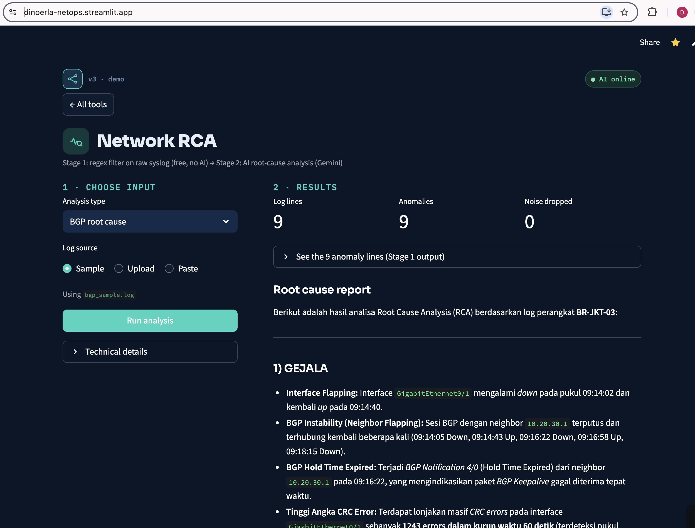
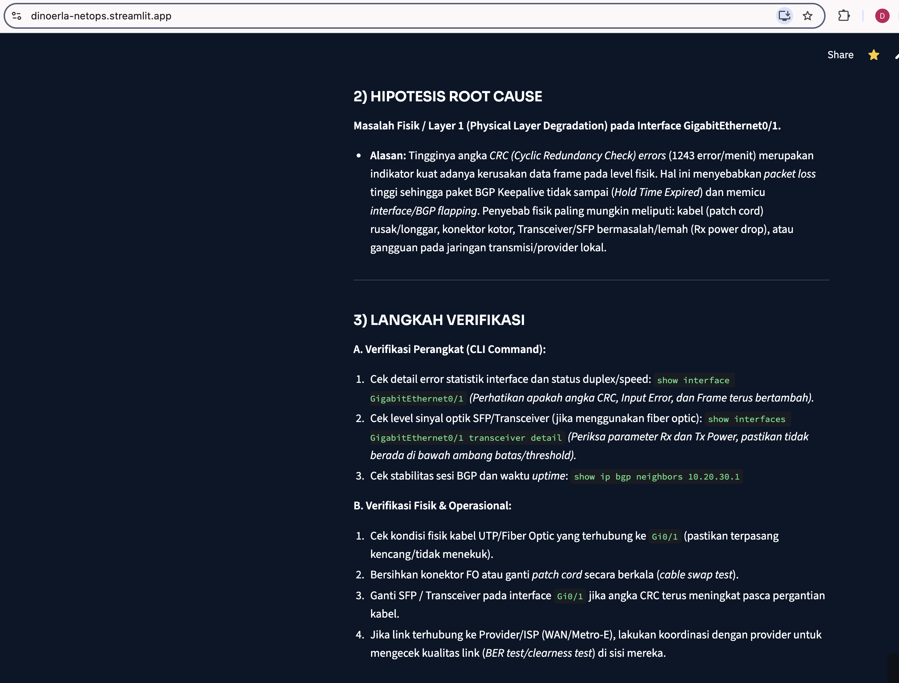

# 01 — Network RCA (AI-assisted)

**Raw syslog in, root-cause analysis out.** A free regex filter runs first; the AI only sees the anomalies.

```
syslog (thousands of lines) → Stage 1: parser.py (regex, no AI, no cost) → anomalies only
                            → Stage 2: engine.py (Gemini) → structured RCA
```

Why two stages: sending a full log to an LLM is slow, expensive and leaks more data than needed.
Like an ACL before the CPU — filter first, then inspect.

## Output structure
Symptoms · most likely root cause · other possible causes · business impact · next verification steps · confidence.
When the log doesn't support a conclusion, the prompt requires the AI to say so.

## Run
```bash
# from the repo root: activate venv and export GEMINI_API_KEY first (see root README)
cd 01-network-rca
python network_rca.py                                # default: data/syslog_raw.log, check bgp_rca
python network_rca.py data/bgp_sample.log bgp_rca    # explicit: <log file> <check>
```

## Files
| File | Role |
|---|---|
| `network_rca.py` | Entry point — runs the funnel: parser → AI |
| `parser.py` | Stage 1: regex anomaly filter (`%BGP-`, `%OSPF-`, `%DUAL-`, `%LINK-3-UPDOWN`, CRC, …) |
| `engine.py` | Stage 2: calls the AI, with automatic retry on 503 |
| `prompts.py` | Prompt library: `bgp_rca`, `ospf_rca`, `config_review` |
| `data/` | Synthetic sample logs |
| `test_rca.py` | Smoke tests (real parser, mocked AI) |
| `deliverables/` | Screenshots from the first dashboard version |

## Screenshots (dashboard)




Case study: [CS-101](../docs/case-studies/CS-101-v2-RCA-banking.md)
