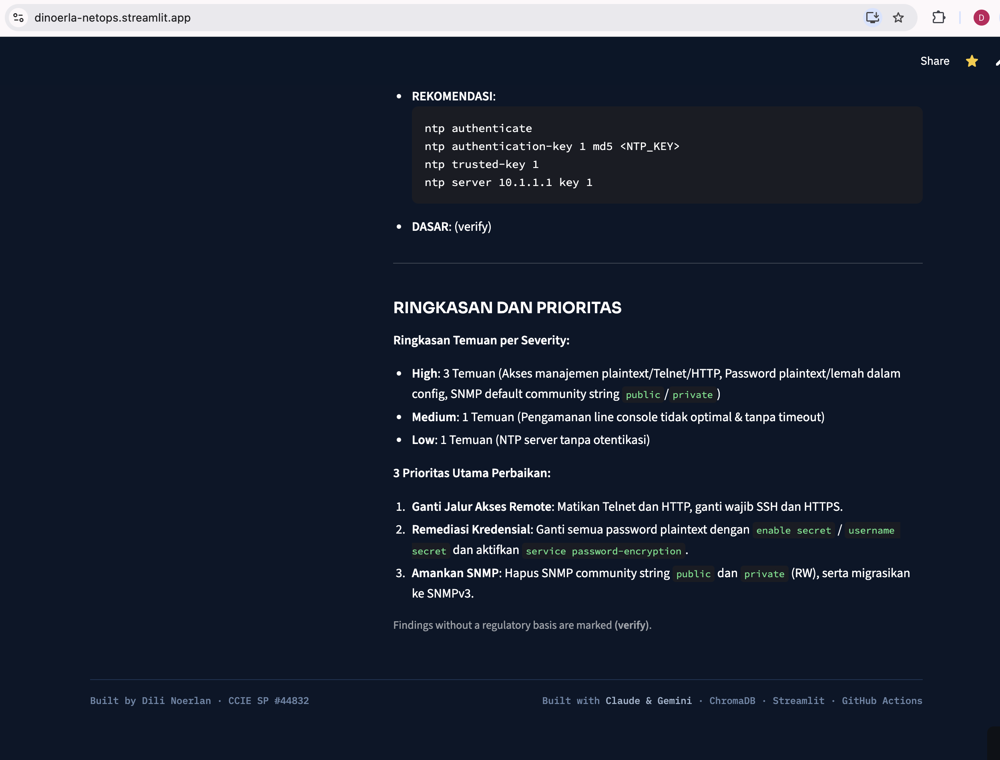

# 02 — Config Review (AI-assisted, RAG-grounded)

**A router configuration checked against security best practice and Indonesian banking regulation, ranked by severity.**
Report only — it never changes a configuration.

## Two versions
| Script | Grounding | Use |
|---|---|---|
| `config_review.py` | None — best practice + general OJK/BI principles. Any specific article reference is marked "(verify)". | Baseline |
| `config_review_rag.py` | **RAG**: retrieves the most relevant passages (top 4) from the real OJK/SEOJK documents in the shared ChromaDB of [`04-ojk-rag`](../04-ojk-rag/), and cites them per finding in a `DASAR` ("basis") field. Findings not supported by the retrieved text keep the "(verify)" flag. | Recommended |

The RAG version reuses `../04-ojk-rag/chroma_db` — it does not re-embed. If that database is missing,
run `ingest.py` in `04-ojk-rag` first.

## Run
```bash
cd 02-config-review
python config_review_rag.py                          # default: data/router_sample.cfg
python config_review_rag.py path/to/your_config.cfg  # mask real hostnames/IPs first
python config_review.py                              # baseline, non-RAG
```

## Files
| File | Role |
|---|---|
| `config_review_rag.py` | RAG version — embed query → retrieve OJK passages → AI review with citations |
| `config_review.py` + `prompts.py` | Baseline version and its prompt |
| `data/router_sample.cfg` | Synthetic router config with deliberate gaps |
| `test_config_review.py` | Smoke tests (mocked AI) |

## Screenshots (dashboard)




Case study: [CS-102](../docs/case-studies/CS-102-v2-config-review-ojk-rag.md)
