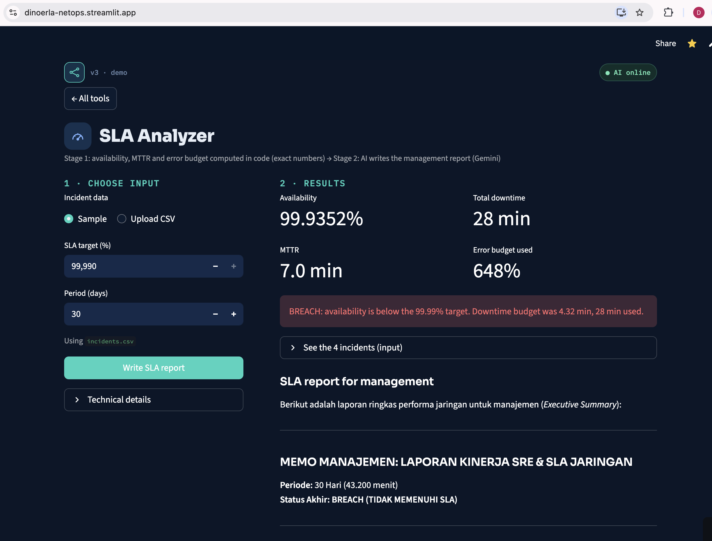
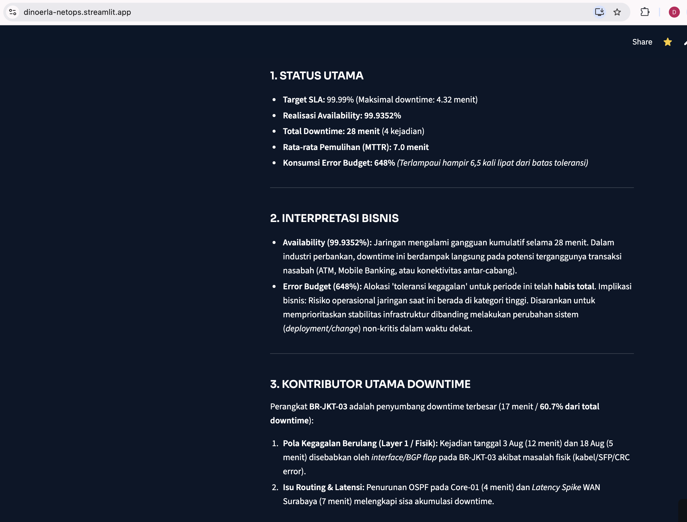
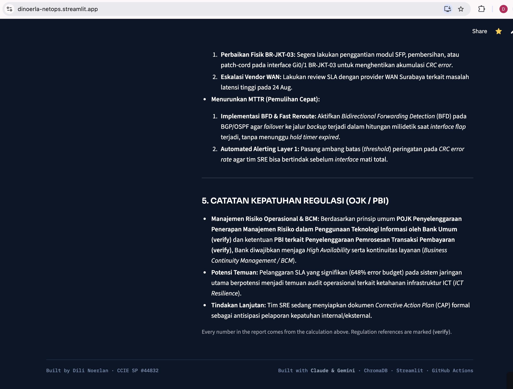

# 03 — SLA & Availability Analyzer (AI-assisted)

**Code does the math, AI writes the story.**

```
incidents.csv → CODE: availability, MTTR, error budget, breach (exact, auditable)
             → AI: management report (status, business meaning, top contributors, actions)
```

LLMs are bad at arithmetic, so the AI never computes a number. The prompt gives it the computed metrics
and forbids recalculating or inventing figures.

## Example result (sample data)
| Metric | Value |
|---|---|
| Availability (30 days) | 99.9352% |
| Total downtime / MTTR | 28 min / 7.0 min |
| Error budget at 99.99% | 4.32 min → **648% used → BREACH** |
| Insight | One branch router (BR-JKT-03) caused ~61% of the downtime — a circuit problem, not a design problem |

## Run
```bash
cd 03-sla-analyzer
python sla_analyzer.py                       # default: data/incidents.csv
python sla_analyzer.py path/to/incidents.csv
```

Settings in `sla_analyzer.py`: `SLA_TARGET` (default 99.99) and `PERIOD_DAYS` (default 30).

## CSV format
```
start,end,severity,description
2026-08-03 02:10,2026-08-03 02:22,High,BGP flap Gi0/1 BR-JKT-03 (CRC/Layer1)
```

## Files
`sla_analyzer.py` (metrics + AI call) · `prompts.py` (report prompt) · `data/incidents.csv` (synthetic) ·
`test_sla_analyzer.py` (smoke tests) · `deliverables/` (screenshots, first dashboard version)

## Screenshots (dashboard)





Case study: [CS-104](../docs/case-studies/CS-104-sla-analyzer.md)
