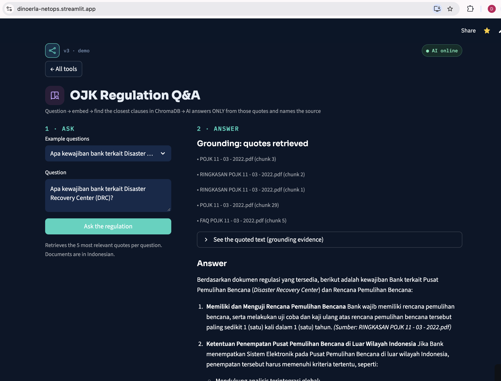
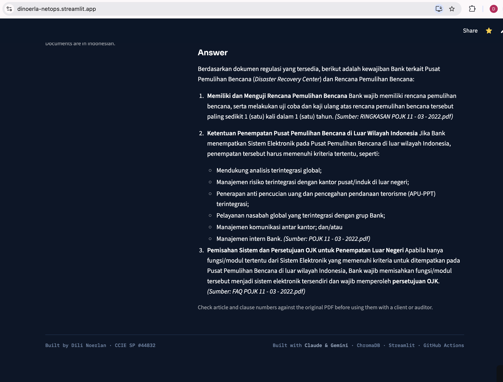

# 04 — OJK Regulation Q&A (RAG)

**Answers about Indonesian banking IT regulation that cite the source — or say "not found".**

RAG (Retrieval-Augmented Generation): before the AI answers, code searches the real regulation documents and gives
the AI only the relevant passages. It's the difference between an engineer quoting the design document and one
answering from memory.

## How it works
| Phase | Script | What it does |
|---|---|---|
| Indexing (once) | `ingest.py` | Read PDFs → 1,200-character chunks (200 overlap) → embed with `gemini-embedding-001` → store in ChromaDB. Re-runs skip chunks already stored. |
| Query | `ask_ojk.py` | Embed the question → retrieve top-5 chunks → AI answers from those chunks only, naming the source |

**Knowledge base:** 5 public OJK documents in `docs/` → 280 chunks — POJK 11/POJK.03/2022 (IT governance for
commercial banks) with FAQ and summary, and SEOJK 29/SEOJK.03/2022 (cyber security and resilience) with summary.

**Honesty guard:** if the passages don't contain the answer, the AI must reply *"Tidak ditemukan di dokumen yang
tersedia"* ("not found in the available documents"). Asking it the price of bitcoin returns exactly that.

## Run
```bash
cd 04-ojk-rag
python ingest.py                                         # build / update chroma_db from docs/*.pdf
python ask_ojk.py "Apa kewajiban bank terkait penempatan pusat data dan DRC?"
python peek.py                                           # inspect what is stored
```

The same database is reused by [`02-config-review`](../02-config-review/) for grounded config reviews.

## Limitations
- Chunks are fixed-size, not per article, so citations point to document + chunk rather than "Article X(Y)".
- The refusal comes from the prompt; a similarity threshold before calling the AI would add defence in depth.
- Any article number in an answer must be checked against the original PDF before audit or client use.

## Screenshots (dashboard)




Case study: [CS-105](../docs/case-studies/CS-105-ojk-rag.md)
