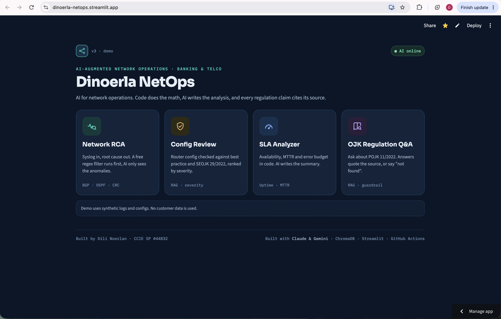
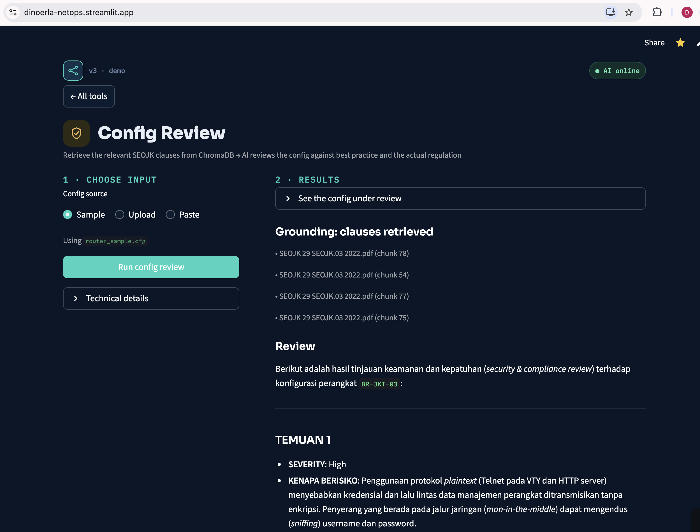
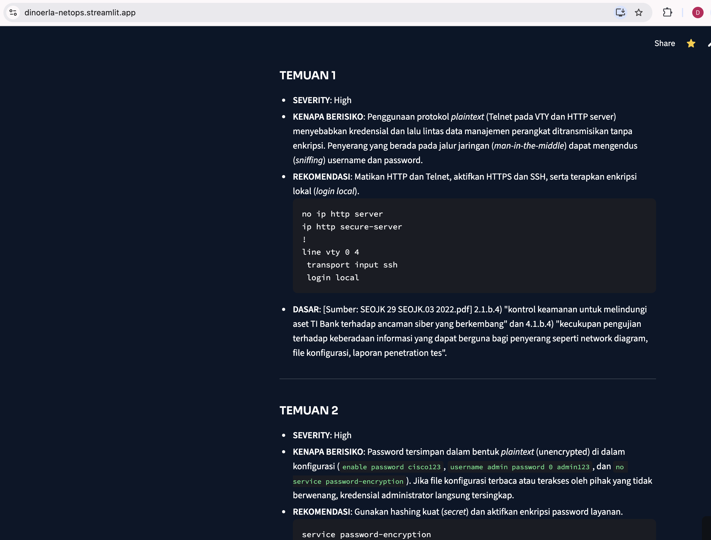
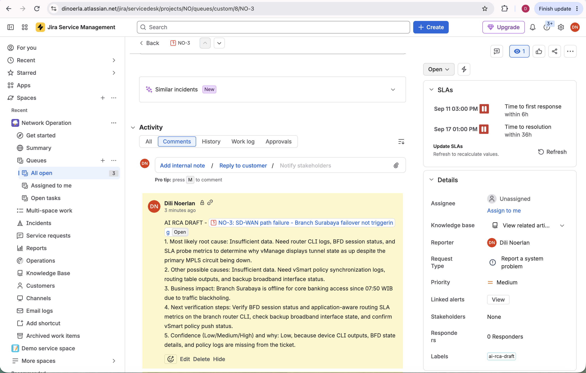
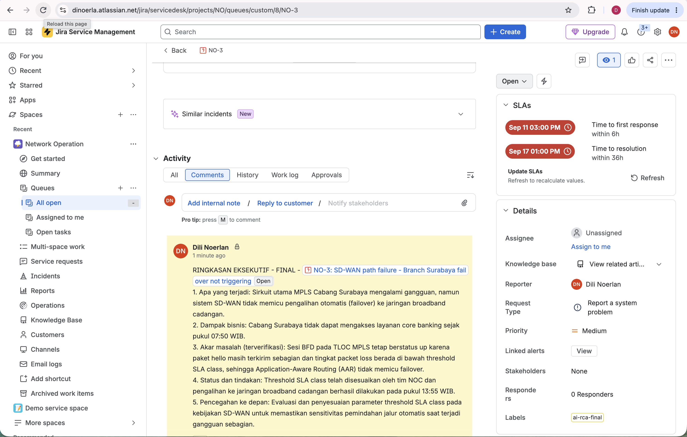
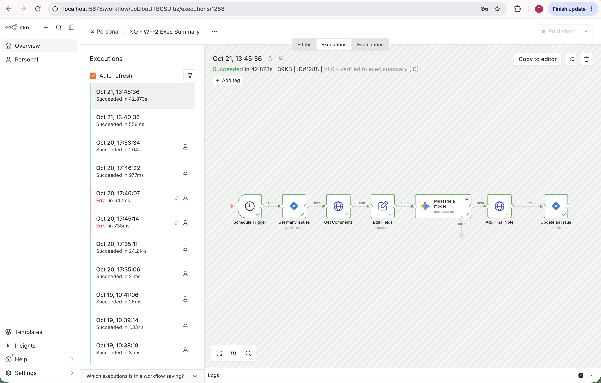
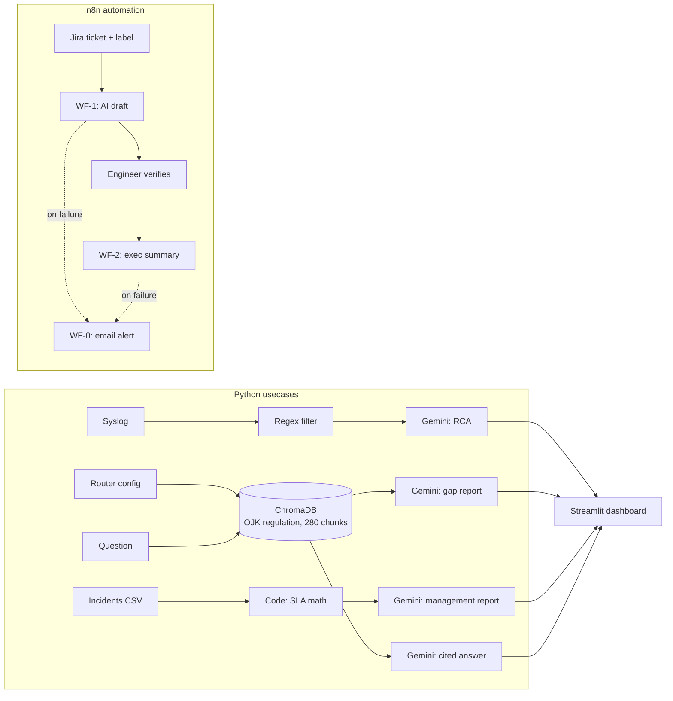

# AI for Network Operations — Banking & Telco

**Practical AI usecases for enterprise network operations, built by a network architect with 25 years in the field.**

I'm Dili Noerlan (CCIE SP #44832, ex-Cisco CX, 16 years). I helped build Indonesia's first MPLS network and spent
the last decade supporting Indonesia's largest telcos and banks. This repo is where I turn that domain knowledge
into working AI tools — small, honest, and designed the way a regulated bank would need them.

> *I bridge AI capabilities and enterprise infrastructure reality — with 25 years of proof.*

---

## The design principle behind every usecase

```
   CODE computes / retrieves   →   AI drafts   →   HUMAN verifies
   (deterministic, auditable)      (language)       (accountability)
```

- **Code does the math and the filtering.** AI never calculates availability or parses 10,000 log lines.
- **AI writes the analysis or summary** — from only the data it is given.
- **A human signs off.** AI output is labelled as a draft; nothing is published to management or customers without review.
- **Honesty guards.** Prompts force "insufficient data" or "not found in the documents" instead of guessing.

---

## Usecases

| # | Usecase | What it does | Stack | Case study |
|---|---|---|---|---|
| 01 | [Network RCA](01-network-rca/) | Raw syslog → regex anomaly filter → AI root-cause analysis | Python, Gemini | [CS-101](docs/case-studies/CS-101-v2-RCA-banking.md) |
| 02 | [Config Review (RAG)](02-config-review/) | Router config → AI gap report against best practice, grounded in real OJK regulation text | Python, Gemini, ChromaDB | [CS-102](docs/case-studies/CS-102-v2-config-review-ojk-rag.md) |
| 03 | [SLA Analyzer](03-sla-analyzer/) | Incident list → code computes availability / MTTR / error budget → AI writes the management report | Python, Gemini | [CS-104](docs/case-studies/CS-104-sla-analyzer.md) |
| 04 | [OJK Regulation Q&A (RAG)](04-ojk-rag/) | Ask questions about Indonesian banking IT regulation; answers cite the source or say "not found" | Python, Gemini embeddings, ChromaDB | [CS-105](docs/case-studies/CS-105-ojk-rag.md) |
| 05 | [AI RCA inside Jira (n8n)](05-n8n-jira-rca/) | Label a ticket → AI draft as internal note → engineer verifies → AI executive summary for management | n8n, Jira Service Management, Gemini | [CS-106](docs/case-studies/CS-106-n8n-jira-ai-rca.md) |
| — | Executive summary | Technical RCA → board-ready summary (now automated in 05 / WF-2) | Prompt + n8n | [CS-103](docs/case-studies/CS-103-v2-exec-summary.md) |

All data in this repo is **synthetic** (sample logs, configs, incidents, tickets). The bank in the case studies,
"PT Bank Arunika", is fictional. Business figures in the case studies are hypotheses to be measured in a pilot.

---

## Screenshots

### Dashboard — "Dinoerla NetOps" (Streamlit, all four Python usecases in one app)

| Home | Network RCA |
|---|---|
|  |  |
| **Config Review (RAG)** | **SLA Analyzer** |
|  |  |
| **OJK Regulation Q&A — answer with sources** | **Config finding with its regulation basis** |
|  |  |

*The AI reports are written in Bahasa Indonesia on purpose — the audience is Indonesian bank NOC and management teams.
More screenshots in each usecase folder's README.*

### Automation — AI RCA inside the ticket flow (n8n + Jira)

| AI draft as an internal note (confidence: Low, asks for data) | Executive summary built from the engineer's verified cause |
|---|---|
|  |  |



---

## Architecture



---

## Engineering practices

| Practice | How |
|---|---|
| Tests | 37 smoke tests (pytest), real parsers + mocked AI calls — CI never calls the AI API |
| CI/CD | GitHub Actions, one job per usecase in parallel; deliverables backed up to Google Drive |
| Secrets | API keys only via environment variables / Streamlit secrets; nothing hard-coded; n8n exports contain credential *names* only |
| Reliability | Automatic retry when the AI API returns 503 (overloaded); n8n error workflow emails the failing node and a link to the run |
| Pinned dependencies | `requirements.txt` pinned; upgrades are deliberate |

---

## Run it locally

```bash
git clone https://github.com/dinoerlanexus-dev/ai-mastery-dev.git
cd ai-mastery-dev
python3 -m venv venv && source venv/bin/activate
pip install -r requirements.txt
export GEMINI_API_KEY="your-key"        # free tier works

streamlit run dashboard_app.py           # the dashboard, or run each usecase from its folder
```

One shared virtual environment serves all usecases. See each folder's README for command-line usage.

---

## Honest limitations

- Built on the Gemini public API for demonstration. A bank deployment would use a regional, enterprise endpoint
  (for example Vertex AI in an approved region — verify availability), private networking, and audit logging.
- Data in this repo is synthetic. Real customer data must be masked before it reaches any AI service.
- Regulation answers must be checked against the original document before any audit or client use.

---

## Repository layout

```
01-network-rca/      02-config-review/    03-sla-analyzer/    04-ojk-rag/    05-n8n-jira-rca/
dashboard_app.py     Streamlit dashboard for 01–04
docs/case-studies/   business write-ups (problem, design, proof, limitations, demo script)
docs/images/         screenshots used in this README
.github/workflows/   CI pipeline
_archive/            earlier versions, kept for reference
```

---

**Contact:** Dili Noerlan — [LinkedIn](https://www.linkedin.com/) *(link to be added)*
